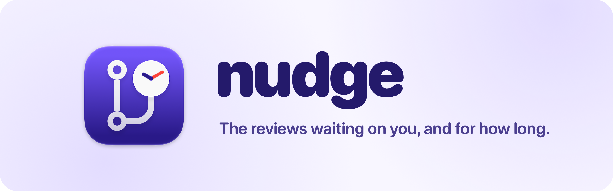
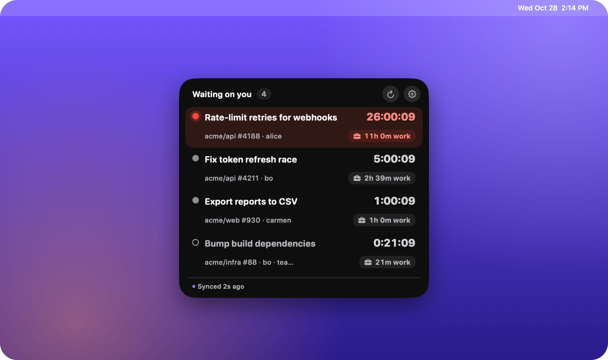
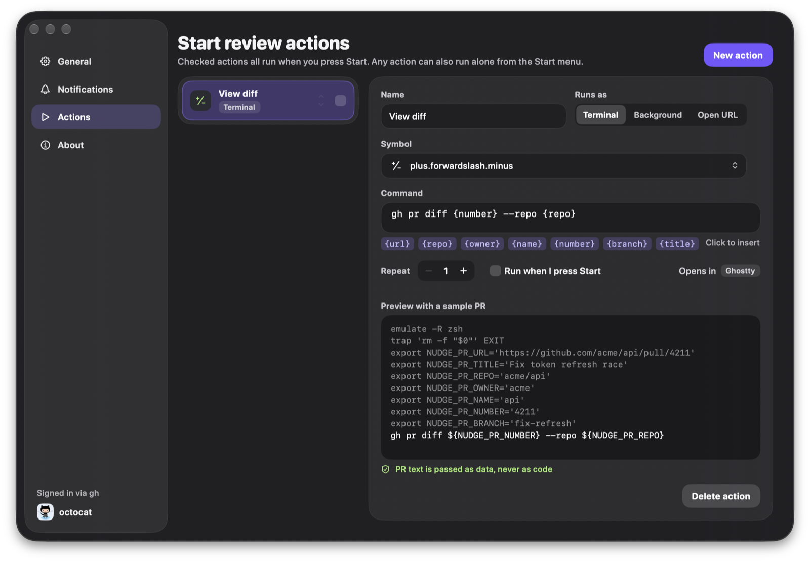
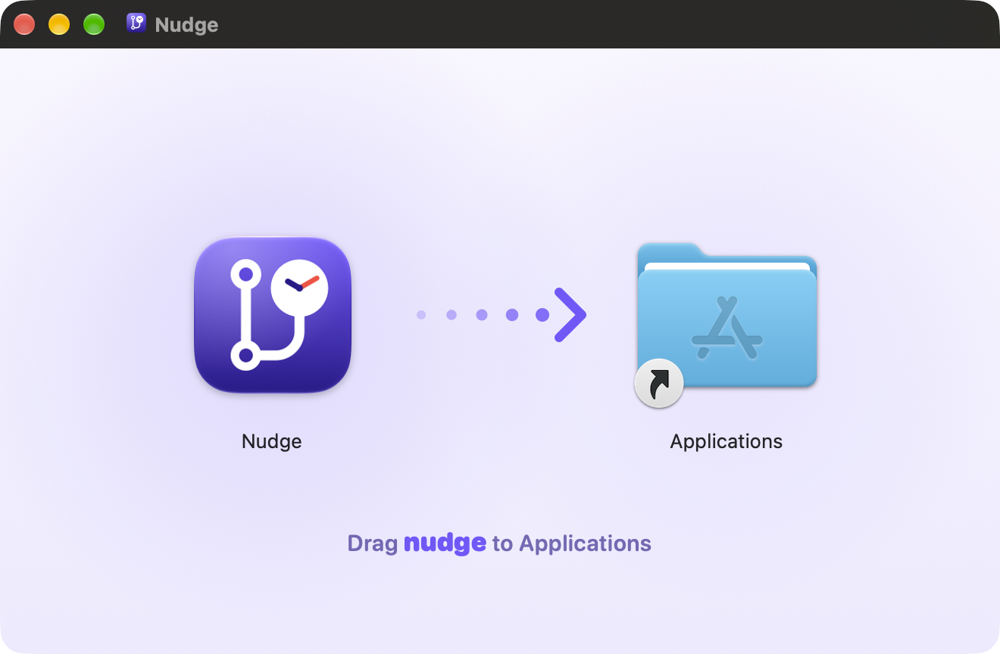

<p align="center">
  <picture>
    <source media="(prefers-color-scheme: dark)" srcset=".github/assets/banner-dark.png">
    
  </picture>
</p>

<p align="center">
  <a href="https://github.com/foobarnes/nudge/releases/latest"></a>
  <a href="https://github.com/foobarnes/nudge/releases"></a>
  
  
  <a href="https://github.com/foobarnes/nudge/actions/workflows/ci.yml"></a>
  <a href="LICENSE"></a>
</p>

<p align="center">
  <b>A tiny macOS menu bar app that tells you when someone requests your review on a GitHub pull request,<br>and shows how long it has been waiting on you.</b>
</p>

<p align="center">
  <a href="https://github.com/foobarnes/nudge/releases/latest"></a>
</p>

<p align="center">
  
</p>

## Features

| | |
| --- | --- |
| ⏱️ **Live timers** | Every PR waiting on you counts up from the moment your review was requested, in real time and in working hours. |
| 🟣 **A glass pill that stays out of the way** | It floats above your work, shows a count and the oldest wait, and expands on hover. Drag it anywhere, or keep Nudge in the menu bar only. |
| 🟠 **Tiers, not noise** | Grey when fresh, amber after 4 working hours, red after 8. One wiggle and one reminder, then it stays quiet. |
| 🔔 **Notifications you control** | Per-org and per-repo rules, snooze, and "hide until re-requested". |
| ▶️ **Start-review actions** | One click runs your own commands in Ghostty, cmux, iTerm2, Warp, WezTerm, kitty, Alacritty or Terminal, opens URLs, or runs scripts in the background. PR text is passed as data, never as code. |
| 🔄 **Updates itself** | Signed, notarized and kept current with Sparkle. |

<p align="center">
  
</p>

## Install

1. Download **[the latest DMG](https://github.com/foobarnes/nudge/releases/latest)**.
2. Drag **nudge** to Applications.
3. Sign in to the [GitHub CLI](https://cli.github.com) once with `gh auth login`. Nudge reads review requests through `gh` and never stores a token of its own.

<p align="center">
  
</p>

Requires **macOS 26 or later**. Nudge updates itself after that.

## Develop

```sh
make bootstrap   # once: tools + Xcode project
make run-debug   # build Debug and launch it
make test        # package tests
```

The design spec lives in [`docs/specs/`](docs/specs/). Every merge to `main` ships a signed, notarized release with generated notes, and PR titles must be [Conventional Commits](https://www.conventionalcommits.org). See [docs/releasing.md](docs/releasing.md).

README images are rendered by [`.github/assets/render.swift`](.github/assets/render.swift).

## License

[MIT](LICENSE)
